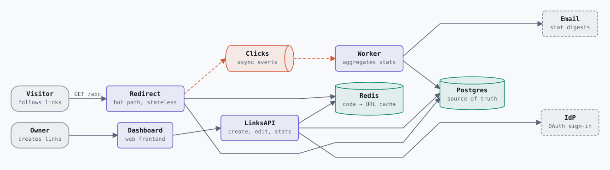
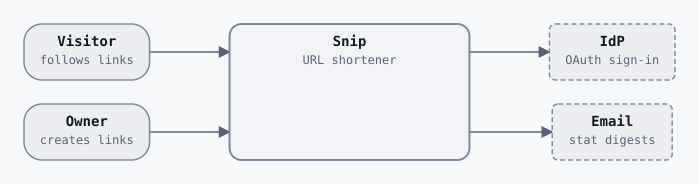
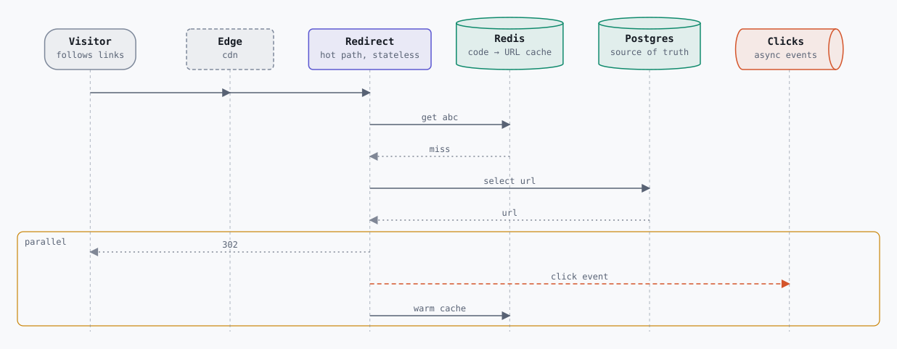
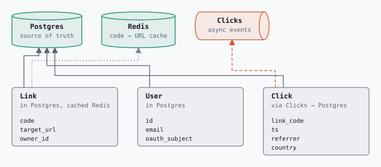
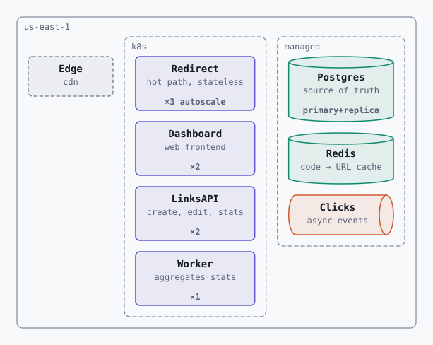
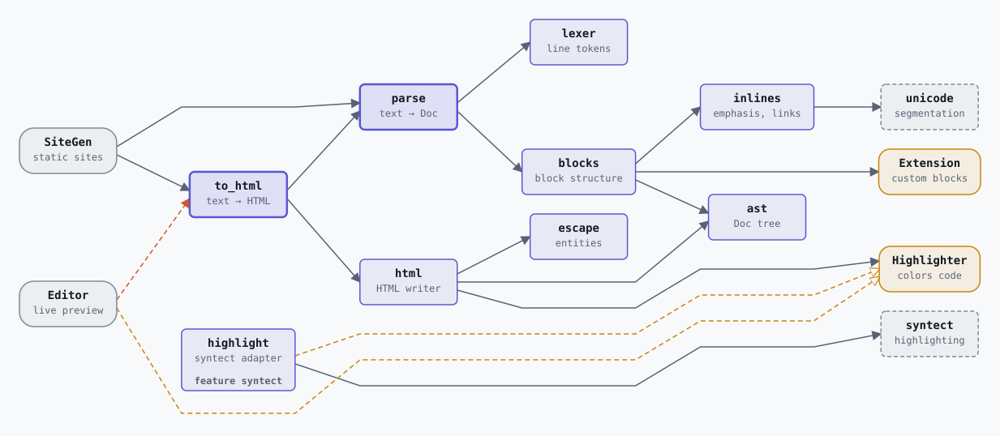

# saxl

saxl (Software Architecture eXpression Language) is a small text language for describing a software system once and generating every architecture view from that one description: context, containers, runtime scenarios, data, deployment, and a 3D "tower" that stacks them all. It can describe a [library](#libraries) the same way.

Because every view comes from the same model, the views can't contradict each other. And because the model is structured, it can be checked: the validator works like a type checker for the architecture, catching scenarios that use connections nobody declared, services with nowhere to run, data with no source of truth, and single points of failure.



## Example

Snip is a toy URL shortener and the reference example ([examples/snip.saxl](examples/snip.saxl)):

```saxl
# Snip: toy URL shortener
system Snip "URL shortener"

actor    Visitor "follows links"
actor    Owner   "creates links"
external IdP     "OAuth sign-in"
external Email   "stat digests"

service Dashboard "web frontend"
service LinksAPI  "create, edit, stats"
service Redirect  "hot path, stateless"
service Worker    "aggregates stats"
store   Postgres  "source of truth"
store   Redis     "code → URL cache"
queue   Clicks    "async events"

Owner     -> Dashboard
Dashboard -> LinksAPI
LinksAPI  -> Postgres
LinksAPI  -> Redis
LinksAPI  -> IdP
Visitor   -> Redirect "GET /abc"
Redirect  -> Redis
Redirect  -> Postgres
Redirect  ~> Clicks
Clicks    ~> Worker -> Postgres
Worker    -> Email

data Link  in Postgres cached Redis { code, target_url, owner_id }
data User  in Postgres              { id, email, oauth_subject }
data Click via Clicks -> Postgres   { link_code, ts, referrer, country }

deploy region us-east-1 {
  cdn Edge
  cluster k8s {
    Redirect x3 autoscale
    Dashboard, LinksAPI x2
    Worker x1
  }
  managed {
    Postgres primary+replica
    Redis
    Clicks
  }
}

scenario redirect_miss {
  Visitor -> Edge -> Redirect
  Redirect -> Redis : get abc
  Redis --> Redirect : miss
  Redirect -> Postgres : select url
  Postgres --> Redirect : url
  parallel {
    Redirect --> Visitor : 302
    Redirect ~> Clicks : click event
    Redirect -> Redis : warm cache
  }
}

scenario redirect_hit {
  Visitor -> Edge -> Redirect
  Redirect -> Redis : get abc
  Redis --> Redirect : hit
  parallel {
    Redirect --> Visitor : 302
    Redirect ~> Clicks : click event
  }
}

allow W102 "single region is acceptable for the prototype"
```

In short: `->` is a synchronous call and `~>` an asynchronous message; `-->` is a reply, used in scenarios. A chain such as `Clicks ~> Worker -> Postgres` declares each hop. Every diagnostic's [documentation](docs/rules/README.md) has a failing and a fixed example.

## Views

Every view below is generated from the file above.

**Context:** the system as one box, with the people and systems around it.



**Runtime:** one scenario as a sequence diagram. Steps in a `parallel` block are bracketed, and requests passing through the CDN show its column.



**Data:** each entity, where its source of truth lives, its caches, and the queue it flows through.



**Deployment:** regions, clusters, and managed services, with replica counts.



**Tower:** an axonometric 3D view. The deployment floor sits at the bottom; containers hang above it in tiers, one per deployment group (in declaration order, top first), each on dashed leaders from its replicas; relations are pipes routed so that unrelated pipes never touch, and a container with four or more outgoing relations sends them through a shared trunk. It is interactive (drag the model to rotate, drag empty space to pan, hover or click to focus, explode the tiers, and play a scenario as tokens moving along the pipes), so it lives in the HTML output, `saxl serve`, and the playground rather than in an image. [examples/shopfront.saxl](examples/shopfront.saxl) is a 24-container example that exercises it.

## Libraries

A file that starts with `library` instead of `system` describes code that other code calls. [examples/quill.saxl](examples/quill.saxl), a toy Markdown library, is the reference example:

```saxl
library Quill "Markdown to HTML"

consumer SiteGen "static sites"
package  syntect "highlighting"

api    to_html     "text → HTML"     at "src/render.rs"
module html        "HTML writer"     at "src/html.rs"
module highlight   "syntect adapter" at "src/highlight.rs"
hook   Highlighter "colors code"

SiteGen   -> to_html
to_html   -> html -> Highlighter
highlight -> syntect
highlight impl Highlighter

data Options in to_html pub { tables, highlighter }

publish "crates.io" {
  crate quill {
    to_html, html
    highlight feature syntect
  }
}
```

| Keyword | Meaning |
|---|---|
| `consumer` | Code that calls the library. |
| `package` | A third-party dependency. |
| `api`, `module` | A public entry point, and an internal component. Consumers may only call an `api`. |
| `hook` | An interface the library calls and someone else implements. `A impl Hook` says who does. |
| `at "glob"` | Optional: where an api's or module's code lives. |
| `pub` | Marks a type as part of the public API. |
| `publish` | The packages the library ships, by registry. `feature f` marks code built only with that feature. |

`~>` is a call that doesn't wait, such as an async method or a channel send. Relations, scenarios, and `allow` work as they do for systems.

The containers, data, and deployment views become **Modules**, **Types**, and **Packages**; `--view modules`, `types`, and `packages` select them. The tower stacks each package as a tier over one floor plate per registry, with hooks outside the boundary so a scenario shows calls leaving the library.



The checks change with the root. For example, [E012](docs/rules/E012.md) catches a consumer calling an internal module, and [W109](docs/rules/W109.md) catches a module that is always built depending on one behind a feature, which builds with default features and fails for anyone who turns the feature off.

## Install

saxl is not published yet. Build the CLI from this repository (Rust 1.97, pinned by `rust-toolchain.toml`):

```bash
cargo install --path crates/saxl-cli
```

## Usage

```bash
saxl init architecture.saxl
```

```bash
saxl check architecture.saxl
```

```bash
saxl render architecture.saxl -o architecture.html
```

```bash
saxl serve architecture.saxl
```

| Command | What it does |
|---|---|
| `saxl check <file>…` | Parse and validate. `--format human\|json\|github`, `--deny warnings`. |
| `saxl render <file> -o <out>` | Render views. The extension picks the format: `.html` (every view, opens on the tower), `.svg` (one 2D view), `.json` (scenes). `--view` and `--scenario` pick a view. |
| `saxl serve <file>` | Serve the views at `http://127.0.0.1:4848` (`--port` to change). The page updates in place whenever the file is saved, keeping the current view and camera. |
| `saxl fmt <file>…` | Rewrite files in canonical form, keeping comments. `--check` lists files that need it and fails instead. |
| `saxl explain [<code>]` | Print a diagnostic's documentation, or list every code. |
| `saxl ir <file>` | Print the model as JSON. `--schema` prints its JSON Schema. |
| `saxl init [<path>]` | Write the Snip example as a starting point. `--library` writes Quill instead. |

Exit codes: 0 for success, 1 when the input has errors (or warnings under `--deny warnings`), 2 for usage and I/O errors.

## Checking

Problems come with stable codes, source labels, and a fix:

```text
E006

  × scenario step has no matching relation
   ╭─[notify.saxl:8:3]
 7 │   Buyer -> Web
 8 │   Web ~> Email : receipt
   ·   ───────────┬──────────
   ·              ╰── no relation `Web ~> Email` is declared
 9 │ }
   ╰────
  help: add `Web ~> Email` to the relations, or route this step through a service that has one
```

[docs/rules](docs/rules/README.md) documents every code with a failing and a fixed example. Errors block rendering; warnings and infos can be allowed with a reason, as Snip does with `allow W102`.

For CI, `--format github` turns diagnostics into pull request annotations, and `--format json` gives machines (and agents) the same diagnostics with line and column ranges.

## Playground

The playground runs the whole toolchain in the browser through WebAssembly: edit on the left, and diagnostics and every view update as you type. It has linked selection between the editor and the views, examples, and share links. CI deploys it to GitHub Pages from `main`.

## Development

```bash
cargo test --workspace
```

```bash
cargo xtask ci
```

| Command | What it does |
|---|---|
| `cargo xtask types` | Regenerate the TypeScript types from the Rust scene and diagnostic types. |
| `cargo xtask viewer` | Bundle the viewer into `crates/saxl-renderer/assets/viewer.js`. |
| `cargo xtask docs` | Regenerate `docs/rules/` and the images in this README. |
| `cargo xtask wasm` | Build the WebAssembly bindings (needs `wasm-bindgen-cli` 0.2.129). |
| `cargo xtask playground` | Build the playground into `playground/web/dist`. |
| `cargo xtask ci` | Run the CI checks locally, including that generated files are current. |

Generated files (TypeScript types, the viewer bundle, rule pages, README images) are committed, so `cargo build` and `cargo test` never need Node. Fuzzing is described in [fuzz/README.md](fuzz/README.md).

| Crate | Role |
|---|---|
| `saxl-core` | Spans, diagnostics, and the model IR |
| `saxl-parser` | Lexer, parser, and formatter |
| `saxl-validator` | Name resolution and the validation rules |
| `saxl-renderer` | Projections, layouts, and HTML, SVG, and JSON output |
| `saxl-cli` | The `saxl` command |
| `playground/wasm` | WebAssembly bindings for the playground |
